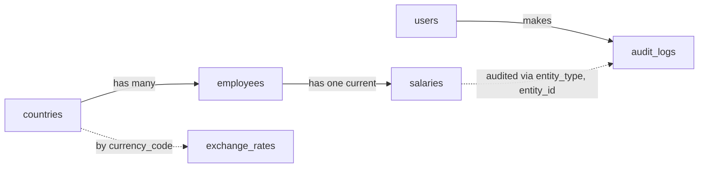

# Salary Management: Design Doc

## Core entities

| Entity | Columns | Notes |
|---|---|---|
| `employees` | `id, first_name, last_name, country_id` | Not the HR users |
| `salaries` | `id, employee_id, base_amount, currency, effective_date` | One current row per employee (unique on `employee_id`); updated in place under a row lock |
| `countries` | `id, name, currency_code, time_zone` | Seeded |
| `exchange_rates` | `currency_code, rate_to_usd, rate_date` | Refreshed by cron twice a day |
| `users` | `id, login, password_digest, role` | HR staff only |
| `audit_logs` | `id, user_id, event_type, entity_type, entity_id, snapshot, note, created_at` | Append-only; logs only the configured salary columns |

## Validation and concurrency

- Names, country and effective date are required
- Base amount must be above zero
- Currency must come from the supported list (each has an exchange rate)
- One salary row per employee: a unique index on `employee_id`, and a duplicate create returns 409
- An update takes a row lock (pessimistic, `with_lock`), so two HR users cannot change the same row at once
- The audit row is written in the same transaction as the update

## API

| Endpoint | Purpose |
|---|---|
| `POST /session` | Login |
| `GET, POST /employees` | List with filters, create |
| `GET, PATCH /employees/:id` | Show with current salary, update |
| `GET, POST /employees/:id/salaries`, `PATCH /employees/:id/salaries/:id` | History from the audit log, add the first salary, update it |
| `GET /reports/salaries-by-country` | Params: `month`, `currency` (default USD) |
| `GET /exports/employees.csv` | CSV export |
| `GET /audit-logs` | HR only |

## Audit and stack

The service writes the audit row in the same transaction as the change. Next.js on Vercel proxies `/api/*` to Rails and Postgres on Render, with all logic in Rails.

Why Postgres:

- JSONB for the audit snapshots
- A composite index on `audit_logs (entity_type, entity_id, created_at)` keeps the join and window-function queries fast
- Aggregate functions for the report: average, min, max, count, and `percentile_cont` for the median

## Salary history and report

- A raise and a typo fix are the same simple update; there is no separate action
- Each update logs the old values to the audit log, for the configured salary columns only (`base_amount, currency, effective_date`); name edits are not logged
- The optional `note` on an audit row is context for readers; the report ignores it
- The report takes the current row plus the audit snapshots, ranks them by effective date descending then last updated descending, and picks the newest on or before the month's last day
- The service sets `event_type` automatically: `salary_changed` when the amount or currency changes, `effective_date_changed` when only the date changes. The report uses only `salary_changed` snapshots, so fixing a mistaken date (for example one set in the future) leaves no wrong history row. Known limitation: if the amount and date are both changed in one update, the old values stay in the history
