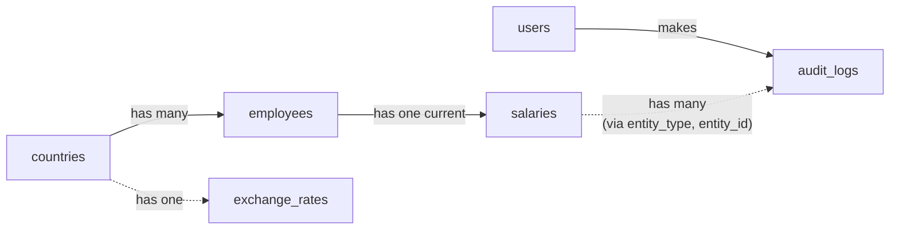

# Salary Management: Design Doc

## Core entities

| Entity | Columns | Notes |
|---|---|---|
| `employees` | `id, first_name, last_name, country_id` | Not the HR users |
| `salaries` | `id, employee_id, base_amount, currency, effective_date, lock_version` | One current row per employee (unique on `employee_id`); updated in place with optimistic locking |
| `countries` | `id, name, currency_code, time_zone` | Seeded |
| `exchange_rates` | `currency_code, rate_to_usd, rate_date` | Seeded for now; a refresh job is planned. The latest row per currency is used |
| `users` | `id, login, password_digest, role` | HR staff only; `role` is `admin` for now |
| `audit_logs` | `id, user_id, event_type, entity_type, entity_id, snapshot, note, created_at` | Append-only; logs only the configured salary columns |

## Validation and concurrency

- Names, country and effective date are required
- Base amount must be above zero
- Currency must come from the supported list (each has an exchange rate); when left out, it defaults to the employee's country's currency
- One salary row per employee: a unique index on `employee_id`, and a duplicate create returns 409. The uniqueness validation catches the usual case; when two creates race past it, the index rejects the second, and that also returns 409
- An update uses optimistic locking (`lock_version`): if a second HR user's update was based on a stale read, it raises a conflict (409) instead of silently overwriting the first user's change
- The audit row is written in the same transaction as the update

## API

| Endpoint | Purpose |
|---|---|
| `POST /session` | Login |
| `GET, POST /employees` | List with filters, create |
| `GET, PATCH /employees/:id` | Show, update |
| `GET, POST /employees/:id/salaries`, `PATCH /employees/:id/salaries/:id` | Current salary plus history from the audit log, add the first salary, update it |
| `GET /reports/salaries-by-country` | Param: `month` (`YYYY-MM`). Returns per-country stats in USD and the `exchange_rates` used, with their dates |
| `GET /exports/employees.csv` | CSV export |
| `GET /audit-logs` | All audit rows, newest first, paginated |

## Access

- Every request needs a bearer token from `POST /session`, except logging in
- Authorization uses CanCanCan. One role for now: `Ability` lets an admin manage everything and anyone else nothing
- Every controller authorizes its actions, and `check_authorization` makes a forgotten check an error rather than an open endpoint. A non-admin gets 403
- `GET /session` is open to any logged-in user, so the UI can always tell who is signed in

## Audit and stack

The service writes the audit row in the same transaction as the change. Next.js on Vercel proxies `/api/*` to Rails and Postgres on Render, with all logic in Rails.

The audit row comes from an `after_update` callback that calls `create!`: it runs inside the update's transaction, so a failed audit write rolls the change back, and a change is never saved without its audit row.

Trade-off: callbacks only run for normal saves. `update_column`, `update_columns`, `update_all`, `insert_all` and raw SQL skip them, so a change made that way is not audited. The app never changes salaries that way, so given the time available a callback was enough. In v2, a Postgres trigger on `salaries` would write the audit row in the database itself, covering every write path; the user and note would be passed in through a transaction-local setting (`SET LOCAL`).

Why Postgres:

- JSONB for the audit snapshots
- A composite index on `audit_logs (entity_type, entity_id, created_at)` keeps the join and window-function queries fast
- Aggregate functions for the report: average, min, max, count, and `percentile_cont` for the median

## Salary history and report

- A raise and a typo fix are the same simple update; there is no separate action
- Each update logs the old values to the audit log, for the configured salary columns only (`base_amount, currency, effective_date`); name edits are not logged
- The optional `note` on an audit row is context for readers; the report ignores it
- The report takes the current row plus the audit snapshots, ranks them by effective date descending then last updated descending, and picks the newest on or before the month's last day
- "Last updated" means when a version was replaced: a snapshot was replaced when its audit row was written (`audit_logs.created_at`), and the current row has not been replaced yet, so it ranks first. Comparing raw timestamps would not work: the audit row is written a moment after `salaries.updated_at`, so the old value would look newer
- No proration: a salary starting on the 20th counts for the whole month
- Each salary is converted with the latest rate for its own currency (not its country's), whatever the month; converted values are never stored
- The service sets `event_type` automatically: `salary_changed` when the amount or currency changes, `effective_date_changed` when only the date changes. The report uses only `salary_changed` snapshots, so fixing a mistaken date (for example one set in the future) leaves no wrong history row. Known limitation: if the amount and date are both changed in one update, the old values stay in the history
