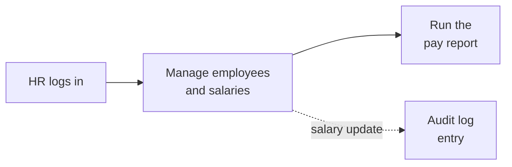

# Salary Management: Requirements

Build a web app that lets ACME's HR manager manage salary data for 10,000 employees across countries, replacing Excel, and answer questions about how the org pays people.

## Goal

Replace Excel with one consistent, secure source of truth for salaries, with reports HR can trust.

## Users and scale

About ten HR users, one primary HR manager. Employees do not log in. A handful of requests per second at most, with mild bursts at month-end and appraisal time.

## Scope and features

- Add and update employees, each with a country
- Add and update employee salary, with its currency and effective date; an employee has one current salary row, updated in place
  - The currency is optional and defaults to the employee's country's currency (an employee in India is paid in INR unless HR picks another)
- View salary history per employee, reconstructed from the audit log

### Reports

- Average salary by country for any month
  - Shown in USD by default
  - Other currencies are a stretch goal; USD only for now
  - A month uses each employee's latest salary on or before that month's last day; a salary starting mid-month counts for the whole month (no proration)
  - Amounts are converted with the latest exchange rate for each currency, for every month; the report lists the rates used and their dates, so HR can see how current the conversion is
- Median, minimum, maximum and employee count by country, for the same month

### Other

- Export employees with their current salary to CSV
- HR login with role-based access; one role for now, Admin, with full access
- Audit log of employee salary updates
- Seed script with 10,000 employees across several countries

HR logs in, manages employees and salaries, then runs the pay report. Salary updates are audited.

## Deliberately left out, and why

| Left out | Reasoning |
|---|---|
| Maker-checker approvals | Version one stays lean; the audit log gives traceability meanwhile |
| Kafka or change data capture for audit | A same-transaction write is simpler and cannot lose entries at this volume |
| Bonus pay (including daily bonus) | Not mentioned in the assignment, so a salary is a single amount |
| Employee self-service | Employees are not users in this version; it can be added later |
| More roles (for example read-only) and a screen to manage users | Only HR uses the app, so one Admin role covers it; CanCanCan makes adding roles a change to one Ability class |
| CSV import | Export is in scope; import is a stretch goal, agreed with the assessors |
| Historical exchange rates and proration | The report converts every month at today's rates and counts a salary for its whole starting month: simple and predictable, so month-to-month changes reflect pay, not currency swings |
| Automatic exchange-rate refresh | Rates are seeded for now; a scheduled refresh job can be added without changing the report |
| Paginated salary history, with who made each change | Version one lists an employee's full history in a collapsible section on their page; v2 moves it to its own paginated endpoint and page, and shows the HR user behind each change |

## Quality requirements

Consistency over availability: a short outage is fine, wrong salary data is not. Small scale, with about ten HR users. Data is encrypted in transit and at rest.
